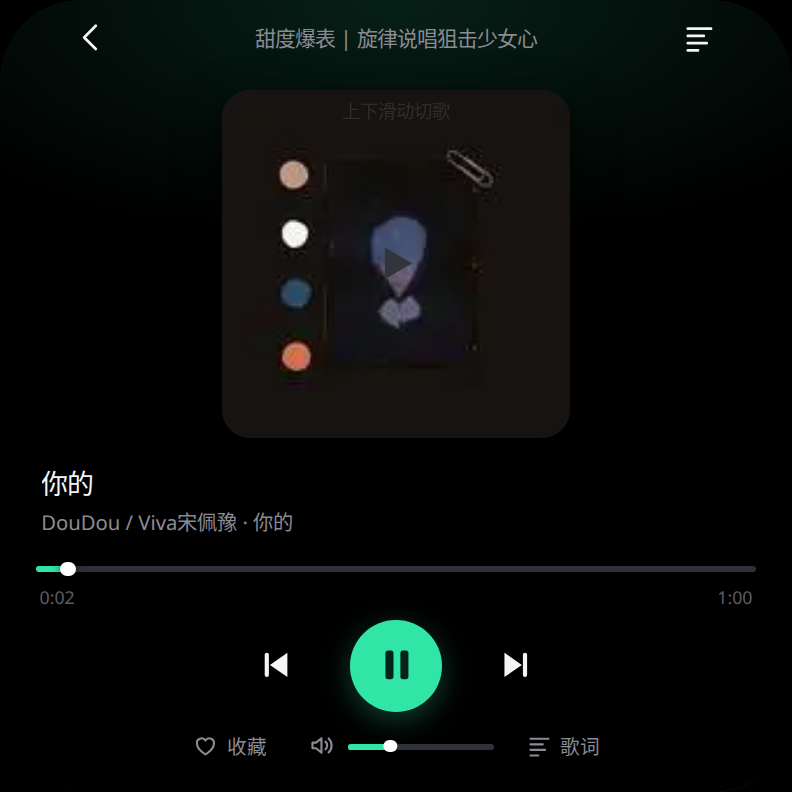
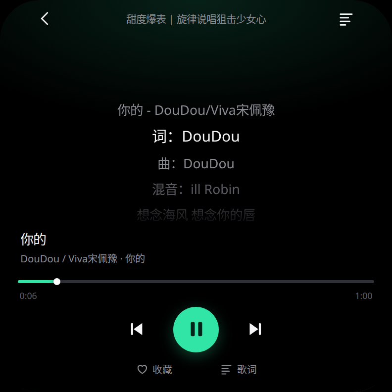

# 手表 QQ 音乐播放器

方形 Wear OS 表盘上的在线音乐播放器。纯原生 Android View 实现，不使用 WebView，APK 不到 100KB。

> 非官方项目，与腾讯、QQ 音乐、微信无关，仅供自用，详见文末[免责声明](#免责声明)。

  

## 主要功能

- **扫码登录**：QQ / 微信扫码，登录态存在本地，重启 App 不用重扫
- **在线听歌**：拖动进度条、上下滑切歌，表冠旋转滚动列表
- **滚动歌词**：独立歌词页，当前行高亮、相邻行渐隐
- **搜索与歌单**：关键词搜索、热门歌单、歌单详情、我的歌单
- **收藏**：与云端「我喜欢」合并去重
- **离线缓存**：播放页一键下载，断网可听，可管理删除
- **音量调节**：底部滑块直接调系统媒体音量，配静音键
- **后台播放**：前台服务 + MediaSession，息屏继续放，控制中心可控

## 安装

手表开好无线调试，然后：

```bash
./install.sh 192.168.1.50        # 换成手表 IP
```

或者手动：

```bash
adb connect 192.168.1.50:5555
adb install -r watch-music.apk
```

`-r` 覆盖安装会保留登录态、收藏和离线缓存，不需要卸载重装。

## 构建

不依赖 Gradle，用 `aapt2 → javac → d8 → zipalign → apksigner` 手工串起来：

```bash
export ANDROID_SDK=/path/to/android-sdk    # 需要 build-tools 34.0.0 与 android-34 平台
cd android-native
./build-native.sh                           # 调试打包，版本号不变
./build-native.sh --release                 # 交付打包，成功后版本号 +1
```

签名密钥放在 `android-native/keystore/watch.jks`，构建脚本存在即复用并打印指纹。**这个文件不进仓库**，自己打包时务必固定保存，否则签名一变就只能卸载重装。

## 目录结构

```
android-native/    独立版源码（纯 View，直连接口），装这个
android/           WebView 版外壳（需配合 server.js 跑在电脑上）
public/            WebView 版前端页面
server.js          单端口服务：静态托管 + 接口代理
qq.js              接口适配层（Cookie 罐、双通道扫码、取流、歌词）
install.sh         一键覆盖安装
```

`android-native` 里几个关键文件：`MainActivity.java`（界面）、`Player.java`（播放队列）、`PlayService.java`（前台服务）、`Qq.java`（接口层）、`LyricView.java` / `BarView.java`（歌词与进度条自绘）。

## 注意

- 接口是 QQ 音乐和微信网页端的私有接口，不是开放平台 API，对方改参数就会失效。
- 未登录拿不到播放地址；需要有账号，部分曲目还要求会员。
- 收藏只写本地，不会回写云端。

## 免责声明

本项目与腾讯公司及其关联公司没有任何隶属、授权或合作关系，不是官方产品。项目名称与界面中出现的服务名称，只用于说明所连接的对象。

### 使用范围

本项目供使用者在自有设备上播放自有账号有权收听的内容。使用者需自行确认其使用方式符合 QQ 音乐、微信的用户协议，以及所在地的著作权法规。因违反上述协议或法规产生的后果，由使用者承担。

### 第三方接口

项目调用的是 QQ 音乐与微信网页端的接口，不属于官方开放平台。这类接口可能随时变更、限流或关闭，作者不承诺其持续可用，也不对由此导致的功能失效、账号受限或数据丢失负责。接口行为由第三方决定，不在本项目可控范围内。

### 代码许可与权利边界

仓库内的源代码按 MIT 许可证授权，全文见 [LICENSE](LICENSE)。该许可只覆盖代码本身，不涉及任何第三方服务、接口、商标、曲库内容或其他第三方素材，也不构成对腾讯公司任何权利的让渡或授权。使用者若要将本项目用于商业用途或对外提供服务，需自行取得相关权利人的许可，并自行评估合规风险。

### 预编译包

仓库内的 APK 是为便于在自有设备上安装而提供的构建产物，不构成对任何第三方内容的再分发。

### 商标

QQ、QQ 音乐、微信、腾讯是腾讯公司或其关联公司的商标。本项目对这些名称的使用属于描述性引用，不代表任何形式的关联或背书。

### 无担保

本项目按现状提供，不附带任何明示或默示的担保，包括适销性、特定用途适用性与不侵权担保。在法律允许的最大范围内，作者不对使用或无法使用本项目造成的任何直接或间接损失承担责任，包括但不限于设备损坏、数据丢失、账号受限与第三方索赔。

### 侵权处理

如权利人认为本仓库的某部分内容侵犯其权利，请通过 Issue 说明具体文件与权利依据。核实后，作者会尽快删除或修改相应内容。

<details>
<summary>English notice</summary>

This is an unofficial project. It is not affiliated with, authorized by, or endorsed by Tencent or its affiliates, and the service names it mentions are used descriptively only.

The source code is licensed under the MIT License (see LICENSE). That license covers the code alone and grants no rights to any third-party service, API, trademark, or media content. The project calls undocumented web endpoints of QQ Music and WeChat. Those endpoints may change, rate-limit, or shut down at any time, and they are used without any warranty of availability.

Use the project only on devices you own, with accounts you own, for content you are entitled to access, and only where such use complies with the applicable terms of service and copyright law. The author accepts no liability for any consequences of use.

</details>

## License

[MIT](LICENSE)
